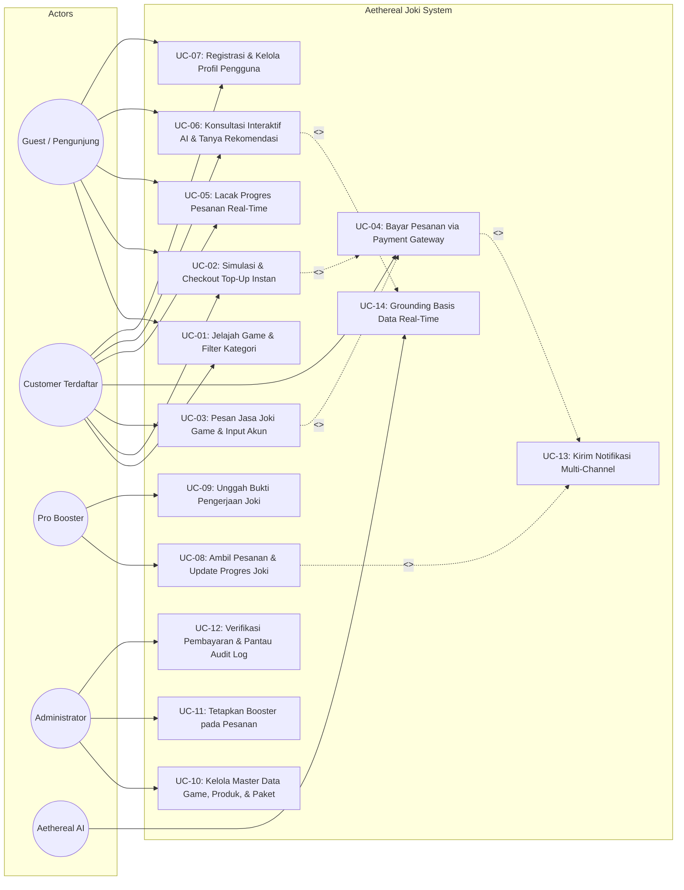
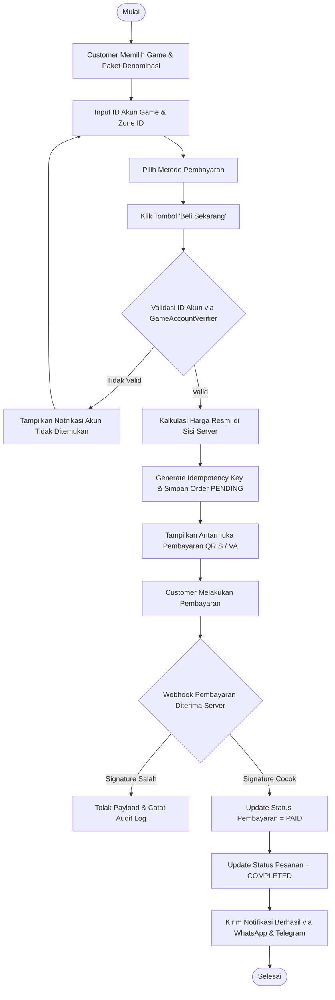
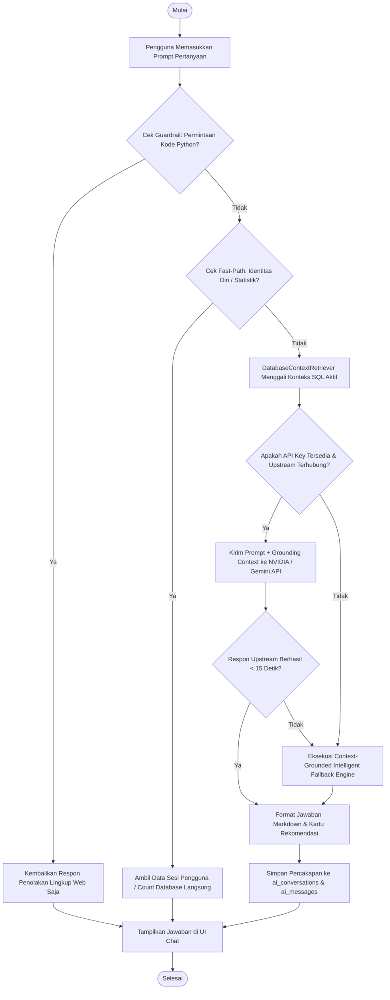
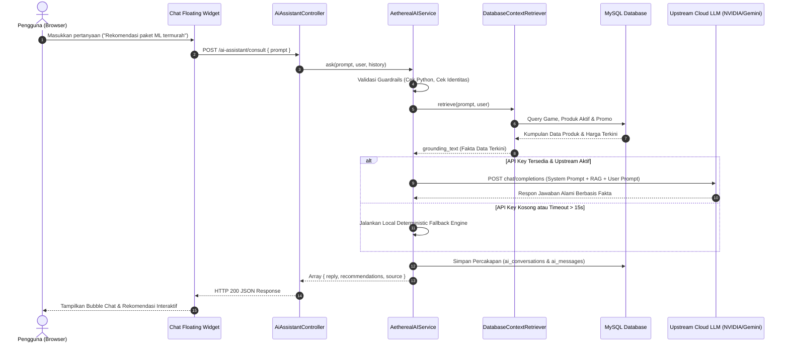
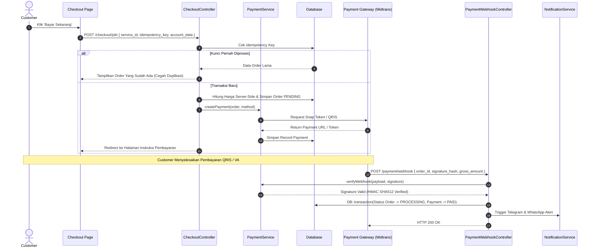
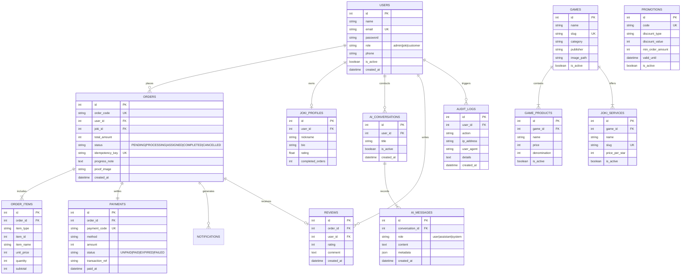

# DOKUMEN PERANCANGAN SISTEM & ARSITEKTUR PERANGKAT LUNAK (SDD)
## PEMODELAN 4 DIAGRAM UML UTAMA, PRINSIP SOLID, ERD & DESAIN UI/UX FIGMA
### PROYEK AKHIR MANDIRI REKAYASA PERANGKAT LUNAK (TIKB2503021) — SEMESTER 3

---

| Parameter | Keterangan |
| :--- | :--- |
| **Nama Aplikasi** | **Aethereal Joki** (Gaming Marketplace & Jasa Joki Terpercaya) |
| **Tema Topik Kelompok** | *Sistem Informasi Berbasis Web untuk Pemberdayaan UMKM Kreatif Digital & Ekosistem Gaming Cerdas Berbasis AI* |
| **Institusi** | Program Studi S1 Teknik Informatika — STMIK IKMI Cirebon |
| **Dosen Pengampu** | **Yudhistira Arie Wijaya, M.Kom., CDS.** |
| **Penyusun / Arsitek Sistem** | **Farrel Surya Pratama** |
| **Sifat Pengerjaan** | Mandiri / Perorangan (100% Individual Ownership & Full-Stack System Design) |
| **Versi Dokumen** | 1.0.0 (Release SDD) |
| **Tanggal Terbit** | 6 November 2026 |

---

## DAFTAR ISI

1. **BAB I: PENDAHULUAN & ARSITEKTUR KESELURUHAN SISTEM**
   - 1.1 Tujuan Perancangan
   - 1.2 Pola Arsitektur Sistem (*Layered & Clean Architecture*)
   - 1.3 Pemetaan Struktur Komponen Terhadap Kerangka Kerja Laravel 12/13

2. **BAB II: PEMODELAN UML DIAGRAM 1 — USE CASE DIAGRAM & SKENARIO**
   - 2.1 Diagram Use Case Sistem Terpadu (4 Aktor)
   - 2.2 Hubungan Dependensi (*Include* & *Extend*)
   - 2.3 Rincian Spesifikasi Tabel Skenario Use Case Utama

3. **BAB III: PEMODELAN UML DIAGRAM 2 — ACTIVITY DIAGRAM ALUR BISNIS & AI**
   - 3.1 Activity Diagram 1: Alur Pemesanan & Pembayaran Top-Up Instan
   - 3.2 Activity Diagram 2: Alur Pemesanan & Siklus Eksekusi Jasa Joki
   - 3.3 Activity Diagram 3: Alur Konsultasi & Inferensi Aethereal AI (RAG Grounding)
   - 3.4 Activity Diagram 4: Alur Verifikasi Admin, Penugasan Booster & Audit Trail

4. **BAB IV: PEMODELAN UML DIAGRAM 3 — CLASS DIAGRAM BERORIENTASI OBJEK & SOLID**
   - 4.1 Diagram Struktur Kelas Lengkap (Models, Services, Controllers, Contracts, Enums)
   - 4.2 Penerapan 5 Prinsip SOLID secara Eksplisit pada Arsitektur Kode:
     - *Single Responsibility Principle (SRP)*
     - *Open-Closed Principle (OCP)*
     - *Liskov Substitution Principle (LSP)*
     - *Interface Segregation Principle (ISP)*
     - *Dependency Inversion Principle (DIP)*

5. **BAB V: PEMODELAN UML DIAGRAM 4 — SEQUENCE DIAGRAM ALUR PERTUKARAN PESAN**
   - 5.1 Sequence Diagram 1: Alur Percakapan Cerdas Aethereal AI (Frontend <-> Backend <-> RAG DB <-> Upstream LLM)
   - 5.2 Sequence Diagram 2: Alur Transaksi Joki, Payment Gateway, dan Webhook Idempoten

6. **BAB VI: PEMODELAN BASIS DATA — ENTITY RELATIONSHIP DIAGRAM (ERD)**
   - 6.1 Diagram Konseptual & Relasional 14 Entitas
   - 6.2 Kamus Data Skema Tabel & Integritas Referensial (*Foreign Keys & Indexes*)

7. **BAB VII: DESAIN UI/UX FIGMA & DESIGN SYSTEM**
   - 7.1 Filosofi Visual (*Futuristic Dark Cyberpunk Gaming Aesthetics*)
   - 7.2 Spesifikasi Token Desain (Palet Warna, Tipografi, Glassmorphism Cards)
   - 7.3 Struktur Tampilan & Prototipe Navigasi Interaktif

---

## BAB I: PENDAHULUAN & ARSITEKTUR KESELURUHAN SISTEM

### 1.1 Tujuan Perancangan
Dokumen Deskripsi Desain Perangkat Lunak (*Software Design Description* - SDD) ini mendokumentasikan spesifikasi arsitektur teknis, struktur data, hubungan antarkomponen berorientasi objek, serta alur perilaku dinamis sistem **Aethereal Joki**. Dokumen ini menjadi jembatan formal antara kebutuhan PRD/SRS dengan implementasi kode web bersih (*Clean Code & SOLID*) untuk memastikan kepatuhan standar Rubrik OBE (Skor 4 - Sangat Baik).

### 1.2 Pola Arsitektur Sistem
Aethereal Joki dibangun menggunakan arsitektur berlapis (*Layered Architecture*) yang memisahkan tanggung jawab secara tegas (*Separation of Concerns*):

```
+--------------------------------------------------------------------------+
|                       PRESENTATION LAYER (UI/UX)                         |
|   Blade Templates + Tailwind CSS v4 + Alpine.js + Responsive Layout      |
+--------------------------------------------------------------------------+
                                    |
                                    v (HTTP Requests / JSON API)
+--------------------------------------------------------------------------+
|                         CONTROLLER & ROUTING LAYER                       |
|   AiAssistantController, CheckoutController, JokiDashboardController,    |
|   AdminController, TopUpController, PaymentWebhookController             |
|   [Middleware: RoleMiddleware, ThrottleRequests, VerifyCsrfToken]         |
+--------------------------------------------------------------------------+
                                    |
                                    v
+--------------------------------------------------------------------------+
|                  DOMAIN SERVICE & CONTRACTS LAYER (SOLID)                |
|   Interfaces: AIServiceInterface, PaymentServiceInterface                |
|   Services: AetherealAIService, DatabaseContextRetriever,                |
|             MidtransPaymentService, MockPaymentService, TelegramService  |
+--------------------------------------------------------------------------+
                                    |
                                    v
+--------------------------------------------------------------------------+
|                   DATA ACCESS & PERSISTENCE LAYER (ORM)                  |
|   Eloquent Models: User, Game, GameProduct, JokiService, JokiProfile,     |
|                    Order, OrderItem, Payment, AIConversation, AIMessage  |
+--------------------------------------------------------------------------+
                                    |
                                    v
+--------------------------------------------------------------------------+
|                           DATABASE ENGINE                                |
|   MySQL / MariaDB (Production/Local Laragon) | SQLite (In-Memory Testing)|
+--------------------------------------------------------------------------+
```

---

## BAB II: PEMODELAN UML DIAGRAM 1 — USE CASE DIAGRAM & SKENARIO

### 2.1 Use Case Diagram Sistem Terpadu
Sistem melibatkan 4 Aktor Utama:
1. **Tamu / Pengunjung (*Guest*)**: Pengguna belum terautentikasi.
2. **Pelanggan (*Customer*)**: Pengguna terautentikasi yang melakukan transaksi.
3. **Pro Booster (*Joki*)**: Penyedia layanan pengerjaan rank game.
4. **Administrator (*Admin*)**: Pengelola operasional master data dan sistem.
5. **Aethereal AI Assistant**: Aktor pendukung otomatisasi kecerdasan artifisial.



### 2.2 Spesifikasi Tabel Skenario Use Case Utama

#### Skenario 1: UC-06 — Konsultasi Cerdas & Rekomendasi Asisten AI
- **Aktor**: Guest / Customer, Aethereal AI Assistant.
- **Prasyarat (*Preconditions*)**: Pengguna mengakses halaman web Aethereal Joki dan membuka jendela chat AI.
- **Kondisi Akhir (*Postconditions*)**: Jawaban faktual berbasis konteks database ditampilkan secara real-time dan riwayat percakapan tersimpan (jika terautentikasi).
- **Alur Utama (*Main Flow*)**:
  1. Pengguna mengetik pertanyaan pada input chat (misal: "Rekomendasikan paket diamond Mobile Legends di bawah Rp 50.000").
  2. Klien mengirimkan request `POST /ai-assistant/consult` dengan payload prompt.
  3. Sistem memvalidasi prompt dan memeriksa guardrails (bukan request kode Python).
  4. Komponen `DatabaseContextRetriever` menggali konteks produk aktif dan harga termurah dari database.
  5. Sistem memanggil upstream LLM (NVIDIA/Gemini) dengan konteks RAG terinjeksi, atau beralih ke local intelligent engine jika offline.
  6. Jawaban terstruktur beserta kartu rekomendasi interaktif dikembalikan ke antarmuka chat pengguna.
- **Alur Alternatif (*Alternative Flow*)**:
  - *A1 (Offline / Tanpa API Key)*: Upstream AI gagal merespons dalam 15 detik; sistem secara otomatis mengeksekusi Fallback Engine deterministik berbasis SQL kontekstual tanpa error ke pengguna.
- **Alur Pengecualian (*Exception Flow*)**:
  - *E1 (Prompt Berisi Permintaan Python Coding)*: Sistem mendeteksi kata kunci dilarang dan langsung mengembalikan pesan penolakan sopan bahwa lingkup AI terbatas pada web engineering.

#### Skenario 2: UC-03 — Pemesanan Jasa Joki Game Anti-Manipulasi
- **Aktor**: Customer.
- **Prasyarat**: Customer telah login dan memilih salah satu game untuk jasa joki.
- **Kondisi Akhir**: Order tersimpan dengan status `PENDING`, detail akun game terenkripsi, dan tautan pembayaran siap diakses.
- **Alur Utama**:
  1. Customer memilih rank awal dan rank target pada kalkulator rank.
  2. Customer menginputkan tipe akun login dan catatan khusus (hero yang diminta).
  3. Customer menekan tombol "Checkout Joki".
  4. Server menghitung total nominal berdasarkan selisih tier di sisi backend, membuat kode pesanan unik `ORD-XXXXXX`, dan menyertakan `idempotency_key`.
  5. Server mengarahkan pengguna ke halaman ringkasan pembayaran.
- **Alur Pengecualian**:
  - *E1 (Rank Target Lebih Rendah Dari Rank Awal)*: Validasi server gagal, menampilkan pesan kesalahan validasi input.

---

## BAB III: PEMODELAN UML DIAGRAM 2 — ACTIVITY DIAGRAM ALUR BISNIS & AI

### 3.1 Activity Diagram 1: Alur Pemesanan & Pembayaran Top-Up Instan


### 3.2 Activity Diagram 2: Alur Konsultasi & Inferensi Aethereal AI (RAG Grounding)


---

## BAB IV: PEMODELAN UML DIAGRAM 3 — CLASS DIAGRAM BERORIENTASI OBJEK & PRINSIP SOLID

### 4.1 Diagram Struktur Kelas Lengkap

```mermaid
classDiagram
    %% Contracts & Interfaces
    class AIServiceInterface {
        <<interface>>
        +ask(string prompt, User user, array history) array
    }

    class PaymentServiceInterface {
        <<interface>>
        +createPayment(Order order, string method) array
        +verifyWebhook(array payload, string signature) bool
    }

    %% Concrete Services
    class AetherealAIService {
        -string provider
        -string apiKey
        -string endpoint
        -string model
        -int timeout
        -DatabaseContextRetriever retriever
        +ask(string prompt, User user, array history) array
        #callUpstreamAi(string prompt, User user, array history) array
        #fallbackResponse(string prompt, User user) array
    }

    class DatabaseContextRetriever {
        +retrieve(string prompt, User user) array
        +isCustomerInquiry(string prompt) bool
        +isTotalUsersInquiry(string prompt) bool
    }

    class MidtransPaymentService {
        -string serverKey
        -string clientKey
        -bool isProduction
        +createPayment(Order order, string method) array
        +verifyWebhook(array payload, string signature) bool
    }

    class MockPaymentService {
        +createPayment(Order order, string method) array
        +verifyWebhook(array payload, string signature) bool
        +simulateSuccess(Order order) bool
    }

    class GameAccountVerifier {
        +verify(string gameCode, string userId, string zoneId) array
    }

    class TelegramService {
        -string botToken
        -string chatId
        +sendMessage(string text) bool
        +sendOrderAlert(Order order) bool
    }

    %% Domain Models
    class User {
        +int id
        +string name
        +string email
        +string role
        +string phone
        +bool is_active
        +orders() HasMany
        +jokiProfile() HasOne
    }

    class Game {
        +int id
        +string name
        +string slug
        +string category
        +bool is_active
        +products() HasMany
        +jokiServices() HasMany
    }

    class GameProduct {
        +int id
        +int game_id
        +string name
        +int price
        +bool is_active
        +game() BelongsTo
    }

    class JokiService {
        +int id
        +int game_id
        +string name
        +int price_per_star
        +bool is_active
        +game() BelongsTo
    }

    class JokiProfile {
        +int id
        +int user_id
        +string nickname
        +string bio
        +float rating
        +int completed_orders
        +user() BelongsTo
    }

    class Order {
        +int id
        +string order_code
        +int user_id
        +string customer_name
        +int total_amount
        +OrderStatus status
        +string idempotency_key
        +string progress_note
        +items() HasMany
        +payment() HasOne
    }

    class OrderStatus {
        <<enumeration>>
        PENDING
        PROCESSING
        ASSIGNED
        COMPLETED
        CANCELLED
    }

    %% Relationships and Inheritances
    AIServiceInterface <|.. AetherealAIService : implements
    AetherealAIService o-- DatabaseContextRetriever : uses
    PaymentServiceInterface <|.. MidtransPaymentService : implements
    PaymentServiceInterface <|.. MockPaymentService : implements

    User "1" -- "0..1" JokiProfile : has
    User "1" -- "0..*" Order : places
    Game "1" -- "1..*" GameProduct : contains
    Game "1" -- "1..*" JokiService : offers
    Order "1" -- "1..*" OrderStatus : has state
```


### 4.2 Penerapan 5 Prinsip SOLID pada Kode Sistem

1. **Single Responsibility Principle (SRP)**:
   - Setiap kelas hanya bertanggung jawab atas 1 urusan domain.
   - `AetherealAIService` fokus mengoordinasikan interaksi percakapan dan guardrails.
   - `DatabaseContextRetriever` dikhususkan untuk pencarian data relevan (*grounding RAG*) ke basis data.
   - `GameAccountVerifier` murni memverifikasi ID akun game.
   - `TelegramService` menangani integrasi Bot API Telegram secara terisolasi.

2. **Open-Closed Principle (OCP)**:
   - Sistem terbuka untuk penambahan provider baru tanpa mengubah kode klien.
   - Penambahan Payment Gateway baru (misal: Xendit, Duitku) cukup mengimplementasikan `PaymentServiceInterface` tanpa mengotori `CheckoutController`.
   - Penambahan AI Provider baru (misal: Claude, DeepSeek) cukup menambahkan logika pada sub-metode tanpa merusak struktur antarmuka `AIServiceInterface`.

3. **Liskov Substitution Principle (LSP)**:
   - Objek `MidtransPaymentService` dan `MockPaymentService` dapat saling menggantikan posisi `PaymentServiceInterface` tanpa mengubah kebenaran program maupun menyebabkan anomali pada controller.
   - Pada lingkungan pengujian, `MockPaymentService` menggantikan Midtrans secara mulus untuk menjamin isolasi tes tanpa dependensi jaringan luar.

4. **Interface Segregation Principle (ISP)**:
   - Interface dirancang secara ramping dan spesifik.
   - Kontrak `PaymentServiceInterface` hanya memuat fungsi-fungsi esensial pembayaran (`createPayment` dan `verifyWebhook`), sehingga tidak membebani kelas implementasi dengan metode yang tidak relevan.

5. **Dependency Inversion Principle (DIP)**:
   - Modul tingkat tinggi (`CheckoutController`, `AiAssistantController`) tidak bergantung langsung pada kelas konkret (`MidtransPaymentService`, `AetherealAIService`), melainkan pada abstraksi antarmuka (`PaymentServiceInterface`, `AIServiceInterface`).
   - Resolusi instansiasi konkret dikelola melalui Laravel Service Container di `AppServiceProvider`.

---

## BAB V: PEMODELAN UML DIAGRAM 4 — SEQUENCE DIAGRAM

### 5.1 Sequence Diagram: Alur Konsultasi Cerdas Aethereal AI (RAG Grounding)


### 5.2 Sequence Diagram: Alur Checkout Transaksi Joki & Webhook Idempoten


---

## BAB VI: PEMODELAN BASIS DATA — ENTITY RELATIONSHIP DIAGRAM (ERD)

### 6.1 Entity Relationship Diagram (14 Entitas Relasional)


---

## BAB VII: DESAIN UI/UX FIGMA & DESIGN SYSTEM

### 7.1 Filosofi Visual & Estetika Antarmuka
Aethereal Joki mengangkat tema **Dark Futuristic Cyberpunk Gaming Ecosystem**, dengan fokus pada kenyamanan visual sesi panjang para gamer (*reduced eye-strain*), aksentuasi *neon neon glow*, dan tata letak modular berbasis *Glassmorphism*.

### 7.2 Spesifikasi Token Desain (Design Tokens)
1. **Palet Warna Utama**:
   - `Background Space`: `#090D16` (Deep Obsidian Void).
   - `Surface Card`: `rgba(17, 24, 39, 0.75)` dengan `backdrop-blur-md` dan garis tepi `border-slate-800/80`.
   - `Cyber Cyan (Primary Accent)`: `#00F0FF` (Digunakan untuk tombol aksi utama, badge aktif, dan pendar futuristik).
   - `Neon Purple (Secondary Accent)`: `#8A2BE2` (Digunakan untuk badge Joki VIP, kategori game MOBA, dan aksen asisten AI).
   - `Emerald Success`: `#10B981` (Status pesanan COMPLETED dan pembayaran PAID).
   - `Amber Warning`: `#F59E0B` (Status pesanan PENDING dan batas waktu checkout).
   - `Rose Alert`: `#F43F5E` (Status pesanan CANCELLED dan pesan error).

2. **Tipografi**:
   - `Heading Font`: *Instrument Sans* / *Orbitron* (Bold, Tracking Wide, Uppercase untuk nuansa Cyberpunk).
   - `Body Font`: *Instrument Sans* / *Inter* (Regular & Medium 400/500, line-height 1.6 untuk keterbacaan tinggi).

3. **Komponen Intuitif**:
   - *Floating AI Widget*: Tombol bulat melayang di pojok kanan bawah dengan animasi denyut (*pulse animation*) pendar cyan, yang membuka modal percakapan ramah jari (*thumb-friendly mobile bottom sheet*).
   - *Interactive Rank Stepper*: Pemilih rank joki visual interaktif yang menampilkan icon bintang dan menghitung estimasi durasi pengerjaan seketika.

---

*Disahkan di Cirebon, 6 November 2026.*  
**Mahasiswa Pengembang (Full-Stack Software Engineer):**  
**Farrel Surya Pratama**  
*(NIM: S1 Teknik Informatika - STMIK IKMI Cirebon)*
